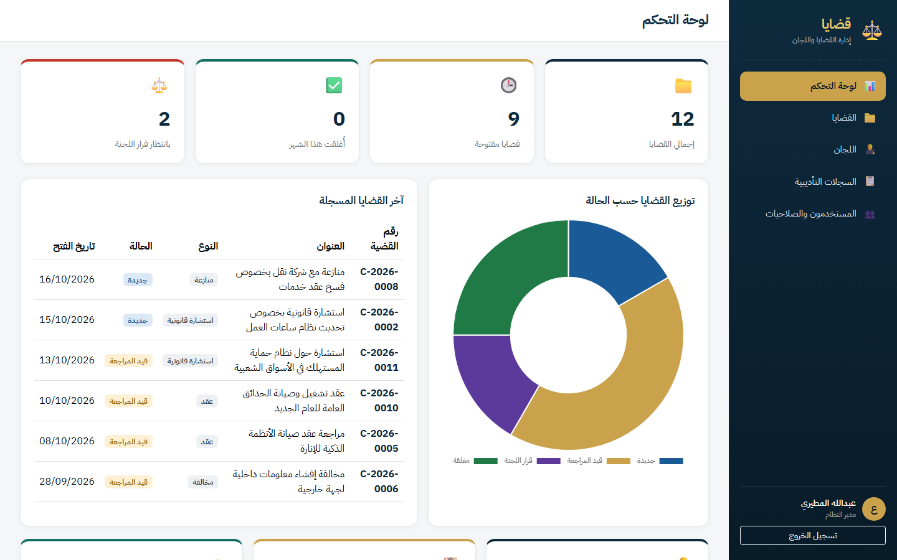
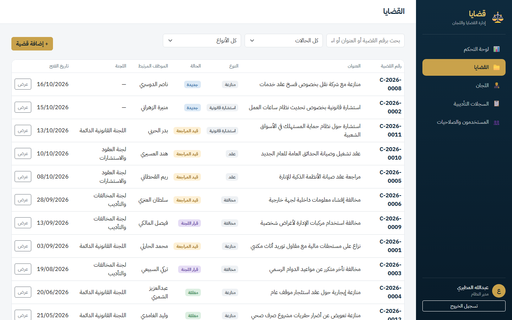
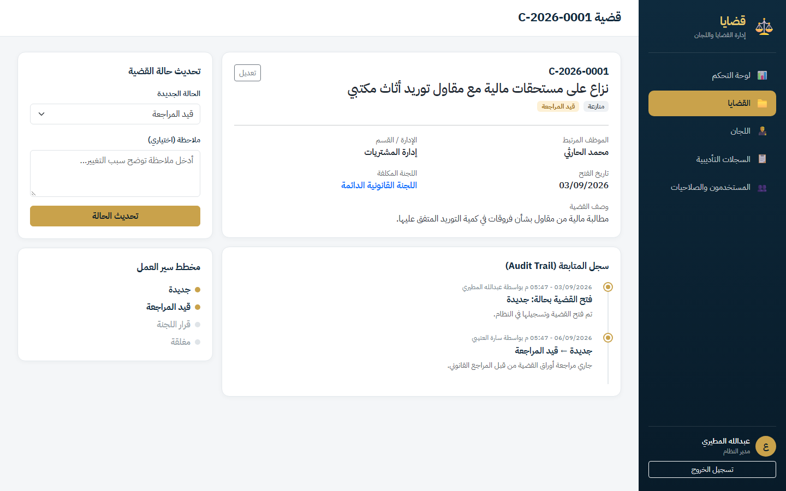
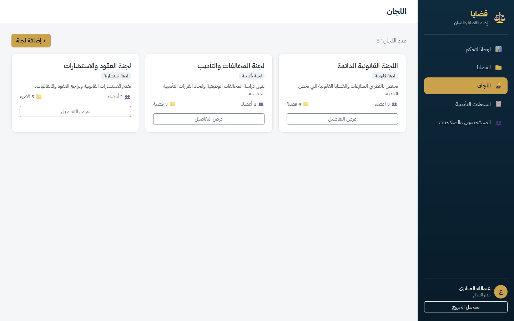

# قضايا ⚖️

نظام "قضايا" هو نظام ويب لإدارة القضايا القانونية واللجان داخل أي جهة حكومية أو مؤسسة — يسجّل القضايا (منازعات، استشارات قانونية، مخالفات، عقود)، يربطها باللجان المختصة والموظفين، ويتابع حالتها من لحظة فتحها لين إغلاقها عبر سجل تتبع كامل (Audit Trail). الفكرة مستوحاة من خبرة عملي الفعلية في بناء نظام "متعلي" لإدارة القضايا واللجان القانونية لإحدى الأمانات (البلديات)، وترجمة متطلبات العمل (BRD) لصلاحيات أدوار (RBAC) ومسارات عمل واضحة.



## وش فيه

- **صلاحيات حسب الدور (RBAC)**: ثلاث أدوار — مدير النظام، مراجع قانوني، موظف — كل دور يشوف ويقدر يسوي أشياء مختلفة، محمية فعلياً على مستوى السيرفر مو بس إخفاء بالواجهة.
- **إدارة القضايا**: إضافة وتعديل وعرض القضايا، مع رقم قضية يتولّد تلقائياً بصيغة `C-2026-0001`، وفلترة وبحث فوري (AJAX) بدون ما تعيد تحميل الصفحة.
- **إدارة اللجان**: كل لجنة إلها أعضاء، نوع، ووصف، وتقدر تشوف كل القضايا المرتبطة فيها.
- **مسار عمل واضح للقضية**: جديدة ← قيد المراجعة ← قرار اللجنة ← مغلقة، وكل تغيير حالة يتسجل في سجل متابعة (Timeline) يبيّن مين غيّر ومتى وليه.
- **السجلات التأديبية**: تسجيل مخالفات الموظفين والقرارات الصادرة بحقهم، مرتبطة بالقضية أو اللجنة.
- **لوحة تحكم**: بطاقات إحصائية (إجمالي القضايا، المفتوحة، المغلقة هالشهر، بانتظار قرار اللجنة) + رسم بياني تفاعلي (Chart.js) لتوزيع القضايا حسب الحالة.
- **واجهة عربية بالكامل** (RTL) بتصميم مخصص وألوان مريحة، مو قالب بوتستراب افتراضي.

## صور

**القضايا** — قائمة كل القضايا مع فلترة فورية بالحالة والنوع والبحث النصي.


**تفاصيل القضية** — صفحة القضية مع سجل المتابعة الكامل (Audit Trail) ومخطط سير العمل.


**اللجان** — بطاقات اللجان مع عدد الأعضاء والقضايا المرتبطة بكل لجنة.


## بيانات تجربة

جرّب النظام بأي من الحسابات التالية (الأدوار مختلفة الصلاحيات):

| الدور | البريد الإلكتروني | كلمة المرور |
|---|---|---|
| مدير النظام | `admin@qadaya.sa` | `Admin@12345` |
| مراجع قانوني | `reviewer@qadaya.sa` | `Reviewer@12345` |
| موظف | `employee@qadaya.sa` | `Employee@12345` |

## التشغيل

يحتاج .NET 10 SDK و SQL Server LocalDB مثبتين عندك.

```bash
# استنساخ المشروع
git clone https://github.com/Mazencoder1/qadaya.git
cd qadaya

# استعادة الحزم
dotnet restore

# إنشاء قاعدة البيانات وتطبيق الـ Migrations (يصير تلقائي أول تشغيل، بس تقدر تسويه يدوي)
dotnet ef database update

# تشغيل المشروع
dotnet run --urls http://localhost:5101
```

بعدها افتح `http://localhost:5101` بالمتصفح، وسجّل دخولك بأحد الحسابات أعلاه. قاعدة البيانات تتعبّى تلقائياً ببيانات تجريبية واقعية (لجان، قضايا، سجلات تأديبية) أول ما تشغّل المشروع.

## التقنيات

- ASP.NET Core 10 MVC (Razor Views)
- Entity Framework Core (Code First + Migrations)
- SQL Server LocalDB
- ASP.NET Core Identity (مصادقة وصلاحيات)
- Bootstrap 5 (RTL)
- JavaScript عادي (Fetch API للبحث والفلترة الفورية)
- Chart.js (الرسم البياني بلوحة التحكم)

---

هذا مشروع تعليمي/بورتفوليو مستوحى من خبرة عمل حقيقية في بناء أنظمة إدارة قضايا ولجان حكومية، وما يمثّل أي نظام حكومي فعلي أو بيانات حقيقية.
